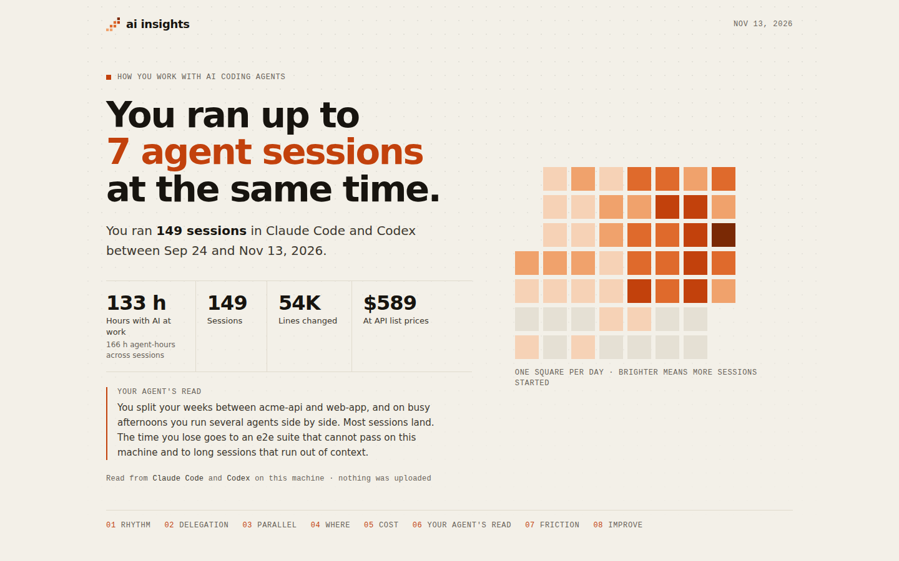

# AI Insights

**Your AI coding, recapped.** One command turns your local agent history (Claude Code, Codex, OpenCode, Pi, Cursor, Gemini CLI) into animated recap cards you can post, and a private analysis of what to change. Nothing leaves your machine.

[](https://ai-insights.app/demo/report.html)

[Website](https://ai-insights.app/) · [Sample recap](https://ai-insights.app/demo/report.html) · [npm](https://www.npmjs.com/package/ai-insights)

AI Insights was called Hindsight until v0.2; `@matrix-os/hindsight` is deprecated in favour of `ai-insights`.

```
npx ai-insights
```

Or, from your agent: install the plugin (below) and run `/analyze-ai-usage`.

## What you get

One self-contained HTML page on your disk, in three parts.

**A recap to share.** Up to 21 animated cards about how you work: your persona, the most agents you ran at once, living dangerously (`rm -rf`, force pushes), your manners, your favourite word, when you prompt, your streak, your bash hall of fame, tests, your top model, tokens, three things to try next, and a summary. A card only appears when your history has the data for it.

<p align="center"></p>

- **Three styles:** Pop (the default), Instrument panel and Sticker sheet.
- **Four shapes:** 1:1, 9:16, 4:5 and 16:9. Each card is laid out again for the shape, so nothing is cropped.
- **A card studio:** pick and order the cards, choose where you will post (X, Instagram feed, Reels, Stories, TikTok, LinkedIn, YouTube Shorts) and see whether the length fits.
- **Export in the page:** an MP4 video (in Chromium browsers today; other browsers get a terminal recipe using headless Chrome and ffmpeg) or PNG images.
- **Share:** X and LinkedIn open with a caption ready; Instagram and TikTok or Shorts get the file saved and the caption copied; your system share sheet where the browser has one.

Cards hold counts and a few allowlisted words only: no prompts, file or project names, paths or session ids. Every card carries the "AI Insights by Matrix OS" mark by default (you can turn it off), and the last card shows how to make your own. The launch hashtag is `#MyAIInsights`.

**A private analysis to act on.** Your rhythm, parallel sessions on a timeline, tokens and cost at API list prices, and findings with the evidence behind them: a command that keeps failing, instructions you keep repeating, sessions that end in a context reset, corrections that come late. Then the changes ranked, each with text to paste into `CLAUDE.md` or `AGENTS.md`, a setting, or a habit to try.

**Over time.** Every run saves a small snapshot. The next run shows what changed since: findings that look resolved, still open, or new.

## Status

Early (0.2). History is read from six agents:

| Agent | History | Tokens | Skill install |
| --- | --- | --- | --- |
| Claude Code | read | yes | plugin |
| Codex | read | yes | plugin |
| OpenCode | read (the database needs Node 22.5 or later) | yes | untested |
| Pi | read | yes | untested |
| Cursor | read | no: its local transcripts hold no token counts | untested |
| Gemini CLI | untested: built from its source format, not yet tried on real history | yes | none yet, use `npx` |

## Install

You need Node.js 20 or newer.

**Without an agent:** `npx ai-insights` writes the report and asks whether to open it (`--open` opens it without asking, `--no-open` never asks; it never asks when piped, in CI or over SSH). `npx ai-insights doctor` shows which history it found and where.

**From your agent:** each install adds the same MCP server (`npx -y ai-insights mcp`) and three skills:
- `analyze-ai-usage` builds the report, with your own agent labelling a sample of sessions and writing a short narrative;
- `ai-insights-coach` turns the findings into edits you review;
- `ai-insights-setup` checks that everything works.

**Claude Code**

```
/plugin marketplace add hamedmp/ai-insights
/plugin install ai-insights@ai-insights
```

**Codex**

```
codex plugin marketplace add hamedmp/ai-insights
codex plugin add ai-insights@ai-insights
```

**Cursor** (untested install): from a clone of this repository, run `scripts/install.sh --harness cursor`. It adds the server to `~/.cursor/mcp.json` and the skills to `~/.cursor/skills`.

**Pi** (untested install): `pi install git:github.com/hamedmp/ai-insights`

**OpenCode** (untested install): from a clone, run `scripts/install.sh --harness opencode`.

**Several harnesses at once:** clone this repository and run `scripts/install.sh`. The script:
- finds the harnesses on your machine;
- copies the skills into each one;
- registers the MCP server with each harness's own `mcp add` command.

It needs no root, writes only inside your home folder, and is safe to run again. Add `--dry-run` to see what it would do first.

Then start a new session and run `/analyze-ai-usage` (or ask your agent to **analyze my AI usage**).

## What it reads

| Harness | Where |
| --- | --- |
| Claude Code | `~/.claude/projects/**/*.jsonl` (or under `CLAUDE_CONFIG_DIR`), `~/.config/claude/projects`, and Claude Desktop's Code and Cowork session stores |
| Codex | `~/.codex/sessions` and `~/.codex/archived_sessions` (or under `CODEX_HOME`) |
| OpenCode | `~/.local/share/opencode/opencode.db` (or `OPENCODE_DB`, `XDG_DATA_HOME`), plus the older `storage/` files. The database needs Node 22.5 or later. |
| Pi | `~/.pi/agent/sessions` (or `PI_CODING_AGENT_DIR`, `PI_CODING_AGENT_SESSION_DIR`), and OMP's `~/.omp` sessions and profiles |
| Cursor | `~/.cursor/projects/*/agent-transcripts` (prompts and tool calls; no tokens) |
| Gemini CLI | `~/.gemini/tmp/*/chats` (or under `GEMINI_CLI_HOME`) |

From each transcript, AI Insights keeps:
- numbers: tokens, durations, tool calls, errors and lines changed;
- the prompts you typed, with secrets redacted.

It does not store the agent's replies or tool output. During analysis, your agent reads short, redacted excerpts on demand.

AI Insights writes everything to `~/.ai-insights/` (set `AI_INSIGHTS_HOME` to move it), and only you can read those files. From 0.5 that includes `device.json`: a random id made once for this installation (16 random bytes, never your computer's name, username or hardware), so the website can keep one entry per computer when you publish from several. If you used it as Hindsight before 0.2 and have a `~/.hindsight/` folder, it keeps using that folder (and still honours `HINDSIGHT_HOME`), so earlier results carry over; nothing is moved or deleted.

It can only look back as far as your agents keep their files. Claude Code keeps local transcripts for 30 days by default (its `cleanupPeriodDays` setting changes that), so run it soon, and raise that setting if you want a longer look back next time.

## Privacy

- **Local only.** No network calls, no telemetry, no account. The report is one HTML file whose Content-Security-Policy (`default-src 'none'`) stops it loading or sending anything.
- **Share links only when you make one.** The report's "Share your stats" box can build a link to a card on the AI Insights site. The link carries only aggregate numbers (an optional display name, the period, sessions, tokens, estimated spend, active days, longest streak, each agent's share of sessions), one fun-fact line and, from 0.4, your earned titles and five work ratios (title keys and numbers only) and your recap cards as short lines of data (a card name, a headline and a caption made only from counts, dates, agent and public model-family names and fixed wording; cards whose report version shows your words, slash commands, program names or tips publish a count instead, or are left out). From 0.5 it also carries this installation's random device id and a name you may type for the computer (for example "Work laptop"), the count each work ratio is out of, and, unless you untick it, which days you were active (dates only, no counts or times), so the site can add up several computers and combine streaks. It travels in the URL fragment, which browsers do not send to the site. It holds no project names, paths, prompts or commands, the box shows every line it contains before you copy it, and nothing is sent unless you copy or click it yourself.
- **The website counts visits; the tool does not.** ai-insights.app (not the package and not the report) uses first-party PostHog analytics, sent through ai-insights.app itself to PostHog's EU hosts: page views and a few named clicks. It never sends a share link's `#fragment`, records no sessions, captures no typed text and honours Do Not Track.
- **The leaderboard is opt-in, on the website.** Nothing in the package publishes anything. An entry on the [leaderboard](https://ai-insights.app/leaderboard/) exists only if you open your share link, sign in with a Matrix account and press **Publish** there. It sends only the lines listed above (numbers and cards), under a public handle you pick, after the page shows you exactly what will be public; your profile at `ai-insights.app/u/<handle>` shows them. Your Matrix account photo is shown only if you tick that box when you publish (off by default); the site then reads it from your Matrix account on its server, and publishing again without the box removes it. The numbers are self-reported and not verified. **Several computers:** publish from each with the same account; each computer keeps its own numbers (told apart by its random device id) and your profile and leaderboard rank use the total. Publishing again from a computer replaces only that computer's numbers; at most 10 computers per account. A computer's name is public only if you tick that box when you publish; otherwise visitors see "Device 1", "Device 2". If two computers publish exactly the same history (a synced home folder), it is counted once and you are told. On your profile, signed in, you can rename or remove a computer, or remove everything. Links from reports before 0.5 have no device id: they publish as one "earlier" device and replace each other, as before.
- **Referrals are first-party and opt-in by action.** Share links the site makes for a published person carry `?ref=<handle>`, and arriving at a profile from outside the site counts too. The site remembers that handle in a first-party cookie on ai-insights.app for 30 days (the first one wins). If you later publish, the site credits that person once (never yourself, never an unknown handle) and records the handle in your Matrix account's metadata. Analytics only ever sees that a link had a referrer, never whose. Your own profile shows you the list of people you referred; visitors see only the count.
- **Share-safe cards.** Cards and captions are built only from counts, allowlisted words and public program, model and agent names. The private analysis never reaches a card.
- **Your agent does the analysis.** AI Insights never calls a model API. The judgement runs in the agent you already use, under your existing account and settings.
- **Redaction.** Before anything is stored or shown, AI Insights redacts common secret formats from prompts, commands and excerpts: API keys, bearer tokens, private keys, `PASSWORD=`-style assignments and email addresses. It also shortens home-folder paths to `~`. Redaction is pattern-based, so it can miss an unusual secret, and the skills tell your agent never to copy one into its notes.

The report links to Matrix OS, to the docs for the tools it suggests, and to X and LinkedIn when you press a share button; nothing else in it points off your machine.

## How the analysis works

1. **Deterministic.** The scan parses your history into sessions. From those it computes activity, the recap, token usage, cost and findings, each with evidence you can check. No model is involved, so the same history always gives the same result.
2. **Run by your agent.** The `analyze-ai-usage` skill has your agent read a redacted excerpt of each session in a sample spread across your history. The agent labels each session with a fixed set of labels covering goal, outcome, friction and what went well, then writes a short narrative. The labels are checked against that set before they are saved, so the charts stay comparable from run to run.

The report combines both layers.

## Matrix OS

AI Insights is built by the team behind [Matrix OS](https://matrix-os.com), the AI operating system we are building. AI Insights is free, MIT licensed and works without it.

## Development

```bash
pnpm install
pnpm check                          # typecheck, tests, generated-file check
pnpm build
node scripts/generate-harness.mjs   # after changing skills/, the version, the icon or the plugin config
```

`skills/` is the only source for the skills. `scripts/generate-harness.mjs` generates every harness manifest, plus the installable plugin in `harness/ai-insights/` that Claude Code and Codex install. CI fails when the generated files are out of date. [AGENTS.md](AGENTS.md) describes the module layout and the rules.

The website lives in `site/`. Its pictures and sample video come from the sample report: `node scripts/demo-report.mjs`, then `pnpm --dir site media`.

Bugs and ideas go to [GitHub issues](https://github.com/hamedmp/ai-insights/issues).

## License

MIT

Token accounting draws on [CodexBar](https://github.com/steipete/CodexBar) (MIT, Peter Steinberger): where Claude Desktop keeps its session stores, and how to recognise a proxy's incomplete Claude usage record.
